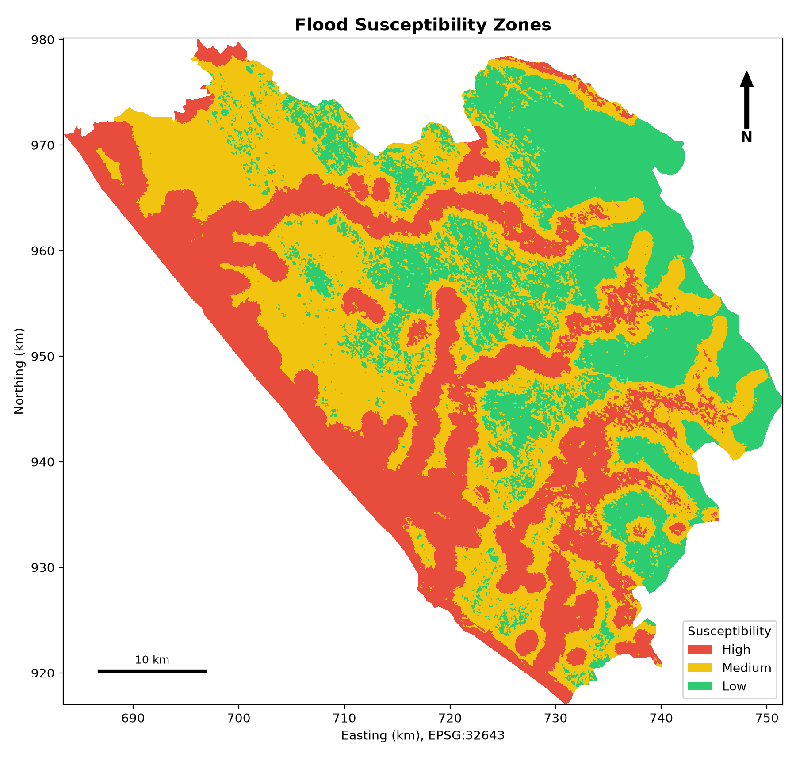

# Flood Susceptibility Demo Tool

[](https://github.com/shannazeer2355/Flood-Susceptibility-Demo-Tool/actions/workflows/tests.yml)

[](LICENSE)
[](https://floodsusceptibility-by-shan.streamlit.app)

A Python GIS pipeline that maps **flood susceptibility (High / Medium / Low)** from a
digital elevation model, distance to rivers and water bodies, and, optionally,
long-term monsoon rainfall, using a multi-criteria weighted overlay. It runs as a
command-line tool or as a [Streamlit web app](https://floodsusceptibility-by-shan.streamlit.app).

Developed during a GIS internship at Avakara GeoScience Research Technologies (AGSRT),
Thiruvananthapuram, for flood susceptibility assessment in Kerala.



*Thiruvananthapuram district with all four criteria (bundled sample data).*

## Method

Each criterion is converted to a 0–1 score, where 1 means most susceptible:

| Criterion | Rule | Weight (3 / 4 criteria) |
|---|---|---|
| **Elevation** | Lower ground is more susceptible. Elevation is normalised to the AOI's own 1st–99th percentile range, then inverted. | 0.4 / 0.3 |
| **Slope** | Flatter ground drains more slowly. Slope (Horn 1981, as in `gdaldem slope`) scores 1 at 0° and falls linearly to 0 at a cutoff (default 15°). | 0.3 / 0.2 |
| **Distance to water** | Closer to rivers and water bodies is more susceptible. Euclidean distance scores 1 within 500 m and falls linearly to 0 at 1500 m. | 0.3 / 0.2 |
| **Rainfall** *(optional)* | Wetter areas are more susceptible. Long-term monsoon-season mean rainfall, normalised to the AOI's 1st–99th percentile range. | – / 0.3 |

The scores are combined as a weighted sum (weights are normalised to sum to 1):

```
score = w_elev·elevation + w_slope·slope + w_water·distance + w_rain·rainfall
```

and classified as **High** (> 0.7), **Medium** (0.4–0.7) or **Low** (< 0.4).
All weights, distances and the slope cutoff can be changed from the command line or
the app's sliders.

### Implementation notes

- **Projection.** Inputs can be in any CRS. The AOI's UTM zone is detected
  automatically and all layers are reprojected to it, so distances and areas are in metres.
- **Memory.** Only the window of the DEM that overlaps the AOI is read and reprojected,
  so large SRTM tiles can be used with small study areas.
- **Slope at the AOI edge.** Before the slope kernel runs, cells outside the AOI are
  filled with the *nearest* valid elevation, so no artificial slopes appear along the boundary.
- **Distance.** The distance transform uses the real pixel width and height, so
  non-square pixels are measured correctly.
- **Rainfall.** The coarse rainfall grid (~5 km) is resampled bilinearly, giving a smooth
  surface instead of 5 km blocks. Where no rainfall value exists, that pixel falls back to
  the three-criteria score rather than being dropped or given an invented value.
- **Continuous distance decay.** A linear decay between the 500 m and 1500 m breakpoints
  avoids the hard edges that fixed buffer rings would create.

## Quick start

```bash
pip install -r requirements.txt
```

`rasterio` and `geopandas` install from pip wheels on Linux and macOS. On Windows, if
pip fails, use `conda install -c conda-forge rasterio geopandas`.

### Command line

Run the bundled Thiruvananthapuram example with rainfall:

```bash
python flood_tool.py \
    --aoi sample_data/trivandrum/boundary.shp \
    --dem sample_data/trivandrum/dem.tif \
    --rivers sample_data/trivandrum/rivers.shp \
    --rainfall sample_data/trivandrum/rainfall.tif \
    --out-dir outputs
```

Options:

```
--rainfall PATH       Optional rainfall raster (adds the 4th criterion)
--settlements PATH    Optional settlement points, counted per zone
--w-elevation W       Elevation weight
--w-slope W           Slope weight
--w-river W           Distance-to-water weight
--w-rainfall W        Rainfall weight (needs --rainfall)
--river-near M        Distance (m) within which the water score is 1   [500]
--river-far M         Distance (m) beyond which the water score is 0   [1500]
--max-slope DEG       Slope (deg) at or above which the slope score is 0 [15]
-v, --verbose         Debug logging
```

A small synthetic dataset (5 × 4 km, with settlements) is included for quick tests:

```bash
python flood_tool.py --aoi sample_data/boundary.shp --dem sample_data/dem.tif \
    --rivers sample_data/rivers.shp --settlements sample_data/villages.shp
```

### Web app

```bash
streamlit run streamlit_app.py
```

Upload your own AOI, DEM, rivers and optional rainfall and settlement layers, or pick a
bundled district. Adjust the weights, view the interactive map and statistics, and
download every output.

## Outputs

| File | Description |
|---|---|
| `flood_susceptibility.tif` | Classified raster (1 = Low, 2 = Medium, 3 = High, 0 = NoData) |
| `flood_susceptibility_zones.geojson` | Zones dissolved into polygons, with area in km² |
| `summary.csv` | Area and share of the AOI per zone, plus settlements per zone |
| `flood_susceptibility_map.png` | Static map with projected coordinates, scale bar and legend |
| `interactive_map.html` | Leaflet map on an OpenStreetMap basemap |

## Sample data

The two bundled districts were prepared in Google Earth Engine:

| Layer | Source |
|---|---|
| Boundary | Kerala district boundary with Local Government Directory (LGD) codes |
| DEM | SRTM 1 arc-second, ~30 m (Farr et al., 2007) |
| Water | Surface-water mask converted to polygons: 30 m for Thiruvananthapuram, 90 m for Ernakulam |
| Rainfall | CHIRPS v2.0, 0.05° / ~5.5 km (Funk et al., 2015): mean June–September total |

- Farr, T. G. et al. (2007). The Shuttle Radar Topography Mission. *Reviews of Geophysics*, 45, RG2004.
- Funk, C. et al. (2015). The climate hazards infrared precipitation with stations — a new
  environmental record for monitoring extremes. *Scientific Data*, 2, 150066.

## Project structure

```
├── flood_tool.py              # Command-line entry point
├── streamlit_app.py           # Web app
├── flood_tool/
│   ├── pipeline.py            # Runs the full workflow
│   ├── io_utils.py            # Loading, reprojection, clipping, resampling
│   ├── terrain.py             # Elevation and slope scores
│   ├── river_distance.py      # Distance-to-water score
│   ├── rainfall.py            # Rainfall score
│   ├── overlay.py             # Weighted overlay and classification
│   ├── outputs.py             # GeoTIFF and GeoJSON writers
│   ├── reporting.py           # Area and settlement statistics
│   └── visualize.py           # Static and interactive maps
├── sample_data/
│   ├── trivandrum/            # Thiruvananthapuram district
│   ├── ernakulam/             # Ernakulam district
│   └── make_sample_data.py    # Generates the synthetic test dataset
├── tests/                     # pytest suite
└── docs/                      # Figures used in this README
```

## Testing

```bash
pip install -r requirements-dev.txt
pytest
```

The tests check each scoring function against known values (for example, the slope of a
plane with a known gradient and distances on non-square pixels), the weighting and
classification rules, and a full run on the synthetic dataset. They run automatically on
every push through GitHub Actions.

## Limitations

- **Susceptibility, not hazard.** The map ranks where flooding is *more likely* from
  terrain, proximity to water and climate. It does not give flood depth, return period
  or probability.
- **Expert-assigned weights.** The weights and class thresholds are not yet calibrated
  against observed floods, so results depend on these choices.
- **Not yet validated.** The natural next step is to compare the zones with mapped flood
  extents, such as the August 2018 Kerala floods, and report accuracy (e.g. ROC/AUC).
- **Input resolution.** SRTM's vertical error is a few metres, which matters on flat
  coastal plains, the ~5 km rainfall grid cannot resolve local rainfall differences, and
  the 90 m water layer for Ernakulam misses narrow channels.

## Possible extensions

- Validate against a flood inventory or Sentinel-1 SAR flood extents.
- Derive weights with the Analytic Hierarchy Process (AHP), or learn them with a
  Random Forest trained on historical flood points.
- Add land cover, soil and drainage density as further criteria.

## Citation

If you use this tool, please cite it using the metadata in [CITATION.cff](CITATION.cff).

## Author

**Mohammed Shan N**: [ORCID 0009-0007-5645-6313](https://orcid.org/0009-0007-5645-6313) ·
[LinkedIn](https://www.linkedin.com/in/mohammed-shan-n-5562051ab) · shangeography@gmail.com

## License

MIT License. See [LICENSE](LICENSE).
